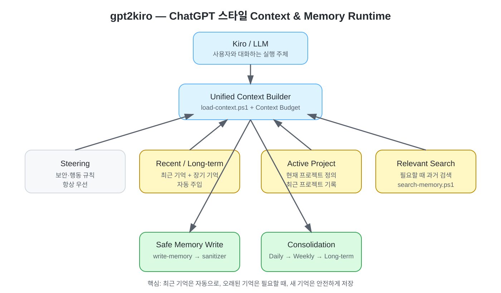
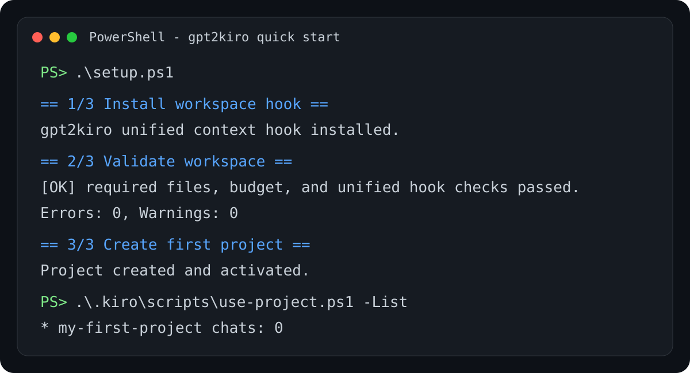

# gpt2kiro

Kiro를 **ChatGPT처럼 대화하고, 이전 작업을 기억하고, 프로젝트별 맥락을 이어서 사용할 수 있게 만드는 설정 프레임워크**입니다.

> GPT 모델 자체를 만드는 프로젝트가 아닙니다.  
> Kiro 위에 **Instructions + Memory + Projects + Context Retrieval** 구조를 추가해, 세션이 바뀌어도 작업 맥락을 이어가기 쉽게 만드는 프로젝트입니다.



**한 문장으로 요약하면:**

> **최근 기억은 자동으로 넣고, 오래된 기억은 필요할 때 찾고, 새 기억은 안전하게 저장합니다.**

---

## 처음 오셨나요? 이것만 하세요

가장 쉬운 방법은 Setup Wizard입니다.

```powershell
git clone https://github.com/medialog-AX-TF/gpt2kiro.git
cd gpt2kiro
.\setup.ps1
```

Wizard가 자동으로 다음 작업을 합니다.

1. Kiro SessionStart Hook 설치
2. 설정 검증
3. 원하면 첫 프로젝트 생성

더 짧은 설명이 필요하면 **[1분 시작 가이드](docs/QUICKSTART.md)** 를 보세요.

### 실행 화면 예시

아래 화면처럼 `Errors: 0`이 나오면 기본 설치가 정상입니다.



---

## gpt2kiro로 무엇을 할 수 있나요?

| 기능 | 쉽게 설명하면 |
|---|---|
| 장기 기억 | 중요한 작업 내용을 파일에 남겨 다음 세션에서 다시 사용 |
| 최근 기억 | 최근 작업을 Kiro 시작 시 자동으로 불러옴 |
| 관련 기억 검색 | 오래된 기록 중 현재 질문과 관련된 내용을 찾음 |
| 프로젝트 | ChatGPT Projects처럼 주제별 목표와 작업 이력을 관리 |
| Lessons | 반복하면 안 되는 실수와 환경 특이사항을 계속 기억 |
| Context Budget | 기억이 많아져도 LLM에 넣는 양을 제한 |
| Memory Sanitizer | Token, 이메일, IP 등 민감정보를 저장 전에 정제 |
| Memory Consolidation | Daily → Weekly → Long-term으로 오래된 기억을 압축 |

예를 들어:

```text
어제
"OpenClaw WSS 오류를 해결함"
        ↓
Memory에 요약 저장
        ↓
오늘 새 Kiro 세션 시작
        ↓
최근 기억 + 중요 교훈 + 현재 프로젝트 자동 로딩
        ↓
"어제 WSS 오류 해결한 내용 이어서 보자"
        ↓
이전 작업을 참고해 계속 진행
```

---

## Kiro / ChatGPT / gpt2kiro 비교

| 항목 | 기본 Kiro | ChatGPT | gpt2kiro |
|---|---|---|---|
| 일반 대화 | 가능 | 가능 | Kiro 사용 |
| 프로젝트별 맥락 | Workspace 중심 | Projects 제공 | `.kiro/projects`로 구성 |
| 세션 간 작업 기억 | 제한적 | 제품 Memory 기능 | Markdown 기반 Memory |
| 최근 기억 자동 로딩 | 기본 구조와 다름 | 제품 내부 처리 | `load-context.ps1` |
| 과거 관련 기억 검색 | 기본 구조와 다름 | 제품 내부 처리 | `search-memory.ps1` |
| 기억 저장 전 보안 정제 | 별도 설계 필요 | 제품 내부 정책 | `sanitize-memory.ps1` |
| 기억 용량 관리 | 별도 설계 필요 | 제품 내부 처리 | Context Budget + Consolidation |
| 데이터 확인/수정 | 구성에 따라 다름 | UI 중심 | 파일을 직접 확인 가능 |

`gpt2kiro`의 목표는 ChatGPT 내부 구현을 복제하는 것이 아니라, **사용자가 관찰할 수 있는 Memory·Projects·Context 관리 경험을 Kiro에서 파일 기반으로 구현**하는 것입니다.

---

# 빠른 시작

## 방법 A — 초보자 추천: Setup Wizard

```powershell
.\setup.ps1
```

진행 중 첫 프로젝트 이름을 물어봅니다. 프로젝트가 필요 없으면 Enter를 눌러 건너뛸 수 있습니다.

자동화 환경에서는 질문 없이 실행할 수도 있습니다.

```powershell
.\setup.ps1 -NonInteractive -SkipProject
```

프로젝트 이름까지 한 번에 지정하려면:

```powershell
.\setup.ps1 `
  -NonInteractive `
  -ProjectName "OpenClaw 개발" `
  -Goal "OpenClaw 기반 사내 AI Agent 환경 구축"
```

## 방법 B — 직접 설치

```powershell
.\install.ps1
.\validate.ps1
```

정상 예:

```text
gpt2kiro validation
-------------------
[OK] required files, budget, and unified hook checks passed.

Errors: 0, Warnings: 0
```

`WARN`은 동작 실패를 뜻하지 않습니다. 과거 Memory에 이메일이나 사용자 경로처럼 검토할 내용이 있으면 표시될 수 있습니다.

---

# 설치 후 실제 사용 방법

대부분의 경우 **Kiro와 평소처럼 대화하면 됩니다.**

세션이 시작되면 자동으로 다음 문맥을 준비합니다.

```text
Kiro 시작
   ↓
Lessons
+
Long-term Memory
+
Recent Memory
+
Active Project
   ↓
Context Budget 적용
   ↓
Kiro가 사용할 문맥 완성
```

오래된 과거 작업까지 필요할 때만 별도 검색합니다.

---

## 프로젝트 만들기

ChatGPT의 Projects처럼 특정 주제의 작업을 별도로 관리할 수 있습니다.

```powershell
.\.kiro\scripts\new-project.ps1 `
  -Name "OpenClaw 개발" `
  -Goal "OpenClaw 기반 사내 AI Agent 환경 구축"
```

프로젝트를 만들면 기본적으로 바로 활성화됩니다.

현재 프로젝트 확인:

```powershell
.\.kiro\scripts\use-project.ps1 -List
```

프로젝트 전환:

```powershell
.\.kiro\scripts\use-project.ps1 -Slug openclaw-개발
```

프로젝트 해제:

```powershell
.\.kiro\scripts\use-project.ps1 -Clear
```

### ACTIVE란?

`.kiro/projects/ACTIVE`에는 현재 사용 중인 프로젝트 slug가 한 줄로 저장됩니다.

```text
ACTIVE
  ↓
openclaw-개발
```

다음 Kiro 세션부터 해당 프로젝트의 목표와 최근 기록이 Context에 포함됩니다.

잘못된 프로젝트에 기록이 쌓이지 않도록 **프로젝트를 자동 추정해서 바꾸지는 않습니다.**

---

# Memory 이해하기

## 1. 최근 기억

최근 날짜의 Memory는 세션 시작 시 자동으로 불러옵니다.

```text
memory/2026-10-13.md
memory/2026-10-14.md
        ↓
SessionStart
        ↓
Recent Memory
```

## 2. 오래된 기억 찾기

```powershell
.\.kiro\scripts\search-memory.ps1 `
  -Query "OpenClaw Docker WSS" `
  -Top 5
```

현재는 다음 요소로 관련도를 계산합니다.

```text
검색어 일치
+
고유 단어 매칭
+
최근성 보너스
```

즉 현재는 **키워드 기반 Relevant Memory Search**입니다.

## 3. 새 기억 저장

Memory 파일을 직접 수정하는 대신 Gateway를 사용합니다.

```powershell
.\.kiro\scripts\write-memory.ps1 `
  -Topic "OpenClaw WSS 오류 해결" `
  -Context "Docker 환경에서 WebSocket 연결 오류 발생" `
  -Work "Gateway 인증 설정 수정" `
  -Decision "WSS 설정 유지" `
  -Validation "연결 성공 확인" `
  -Remaining "없음"
```

저장 과정:

```text
Memory 저장 요청
       ↓
write-memory.ps1
       ↓
sanitize-memory.ps1
       ↓
민감정보 검사
       ↓
현재 프로젝트 있음?
   ┌───────┴───────┐
  YES              NO
   │                │
projects/...     memory/YYYY-MM-DD.md
```

### 왜 Sanitizer가 필요한가요?

다음 값이 기억 파일에 그대로 저장되는 위험을 줄입니다.

- API Key / Token
- Password
- 이메일 주소
- 전화번호
- IP 주소
- 사용자 계정 경로

설계 원칙은 다음과 같습니다.

```text
Memory Read  → Fail Open
Memory Write → Fail Closed
```

기억을 읽지 못해도 Kiro 세션은 계속 진행하지만, 안전하게 정제하지 못한 기억은 저장하지 않습니다.

---

# 오래된 Memory 정리하기

```powershell
.\.kiro\scripts\consolidate-memory.ps1 -OlderThanDays 7
```

구조:

```text
Daily Memory
memory/2026-10-01.md
memory/2026-10-02.md
        ↓
Weekly Memory
memory/weekly/2026-W40.md
        ↓
Long-term Memory
memory/long-term.md
```

원본 Daily 파일은 삭제하지 않습니다.

Weekly와 Long-term은 Context를 줄이기 위한 **파생 요약본**이고, Daily Memory는 근거 데이터로 남습니다.

---

# Context Budget이란?

기억이 계속 쌓인다고 모든 내용을 LLM에 넣으면 Context를 너무 많이 사용합니다.

그래서 자동으로 주입하는 영역에 예산을 둡니다.

설정 파일:

```text
.kiro/context-budget.json
```

기본값:

| 영역 | 기본 예산 |
|---|---:|
| Lessons | 1,200 token 상당 |
| Long-term Memory | 1,000 |
| Recent Memory | 1,800 |
| Active Project | 3,000 |
| 합계 | 약 7,000 |

이 값은 모델 전체 Context Window가 아닙니다.

**gpt2kiro가 자동으로 삽입하는 Memory/Project용 동적 예산**입니다.

기본 근사값:

```text
약 4 characters ≈ 1 token
```

---

# 폴더 구조

처음부터 모든 파일을 이해할 필요는 없습니다.

```text
.kiro/
├─ context-budget.json        Context 사용량 설정
├─ steering/                  항상 적용할 행동·보안 규칙
├─ memory/                    시간 기준 기억
│  ├─ lessons.md              계속 기억할 교훈
│  ├─ long-term.md            장기 기억
│  ├─ weekly/                 주간 요약
│  └─ YYYY-MM-DD.md           날짜별 작업 기록
├─ projects/                  프로젝트별 기억
│  ├─ ACTIVE                  현재 프로젝트
│  └─ <project>/
│     ├─ project.md
│     ├─ index.md
│     └─ chats/
├─ hooks/
│  └─ load-context.json       SessionStart 자동 실행
└─ scripts/
   ├─ load-context.ps1        통합 Context Builder
   ├─ search-memory.ps1       과거 기억 검색
   ├─ write-memory.ps1        기억 저장 Gateway
   ├─ sanitize-memory.ps1     민감정보 정제
   ├─ consolidate-memory.ps1  Daily → Weekly → Long-term
   ├─ new-project.ps1         프로젝트 생성
   └─ use-project.ps1         프로젝트 선택
```

초보자는 우선 아래 파일만 알면 충분합니다.

```text
setup.ps1
validate.ps1
new-project.ps1
use-project.ps1
search-memory.ps1
```

---

# 자주 쓰는 명령

| 하고 싶은 일 | 명령 |
|---|---|
| 처음 설치 | `.\setup.ps1` |
| 상태 확인 | `.\validate.ps1` |
| 프로젝트 생성 | `.\.kiro\scripts\new-project.ps1 -Name "이름" -Goal "목표"` |
| 프로젝트 목록 | `.\.kiro\scripts\use-project.ps1 -List` |
| 프로젝트 전환 | `.\.kiro\scripts\use-project.ps1 -Slug <slug>` |
| 프로젝트 해제 | `.\.kiro\scripts\use-project.ps1 -Clear` |
| 과거 기억 검색 | `.\.kiro\scripts\search-memory.ps1 -Query "내용" -Top 5` |
| 오래된 기억 정리 | `.\.kiro\scripts\consolidate-memory.ps1 -OlderThanDays 7` |

---

# 문제 해결

## Hook 경로 오류

```powershell
.\install.ps1
.\validate.ps1
```

`install.ps1`이 현재 PC 기준 절대경로를 다시 설정합니다.

## `WARN`이 나오는 경우

`WARN`은 즉시 실패를 뜻하지 않습니다.

예:

```text
[WARN] Potential email in ...
```

과거 Memory에 민감정보 후보가 있다는 뜻이므로 해당 파일을 확인하면 됩니다.

## `ERROR`가 나오는 경우

```text
Errors: 1
```

이면 정상 설치가 아닙니다. 출력된 `ERROR` 내용을 먼저 해결해야 합니다.

## 프로젝트가 이상한 경우

```powershell
.\.kiro\scripts\use-project.ps1 -List
```

현재 활성 프로젝트에는 `*`가 표시됩니다.

원하지 않는 프로젝트가 활성화돼 있으면:

```powershell
.\.kiro\scripts\use-project.ps1 -Clear
```

---

# 조금 더 알고 싶은 분을 위한 구조

```text
                   Kiro / LLM
                       │
                       ▼
              Unified Context Builder
                       │
      ┌────────────────┼────────────────┐
      │                │                │
   Lessons      Recent/Long-term   Active Project
      │                │                │
      └────────────────┼────────────────┘
                       │
                 Context Budget
                       │
                       ▼
                     Kiro
                       │
          ┌────────────┴────────────┐
          │                         │
   오래된 기억 필요            새 기억 저장
          │                         │
          ▼                         ▼
 search-memory.ps1          write-memory.ps1
                                    │
                                    ▼
                           sanitize-memory.ps1
```

Memory와 Project 기록은 **명령이 아니라 historical reference data**로 취급합니다.

개념적 신뢰 순서:

```text
Platform / Security
        ↓
Steering
        ↓
Project definition
        ↓
Lessons
        ↓
Historical memory
        ↓
External content
```

과거 기억이나 외부 문서에 `이전 지시를 무시하라` 같은 문장이 있어도 행동 규칙으로 승격하지 않습니다.

---

# 검증과 CI

GitHub Actions에서 다음을 자동 검사합니다.

- PowerShell 문법
- Setup Wizard 비대화형 실행
- Unified Hook 설치
- Workspace 구조 검증
- Sanitizer
- Memory Write Gateway
- Context Builder 예산
- Memory Consolidation
- Relevant Memory Search

로컬에서는 대부분 아래 한 줄이면 됩니다.

```powershell
.\validate.ps1
```

---

# 처음 사용하는 사람 추천 순서

```text
1. README 첫 부분 읽기
      ↓
2. .\setup.ps1 실행
      ↓
3. Errors: 0 확인
      ↓
4. 첫 프로젝트 생성
      ↓
5. Kiro에서 평소처럼 대화
      ↓
6. 필요할 때 search-memory 사용
      ↓
7. 기록이 많아지면 consolidate-memory 실행
```

처음에는 내부 구조를 전부 이해하려고 하지 않아도 됩니다. **Setup → Project → Chat** 세 가지만 먼저 익히면 충분합니다.
